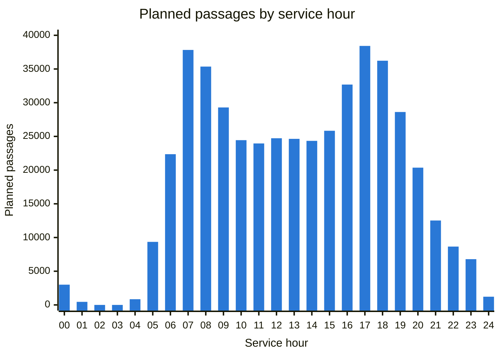
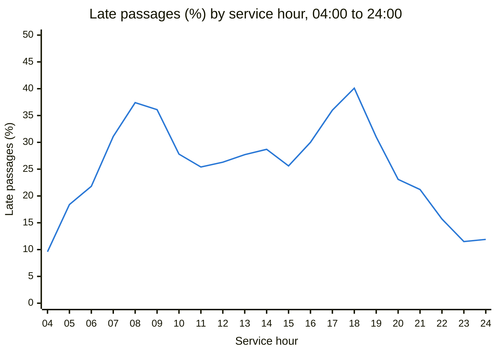
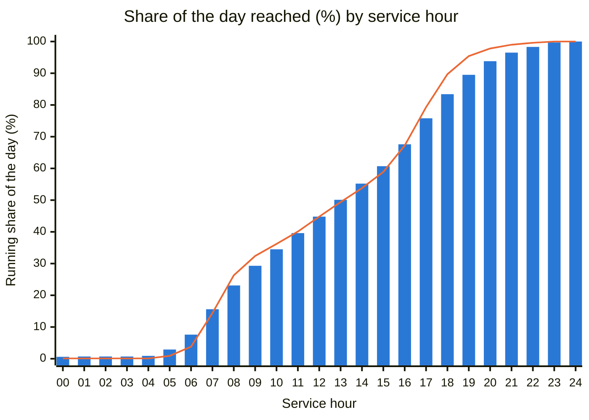
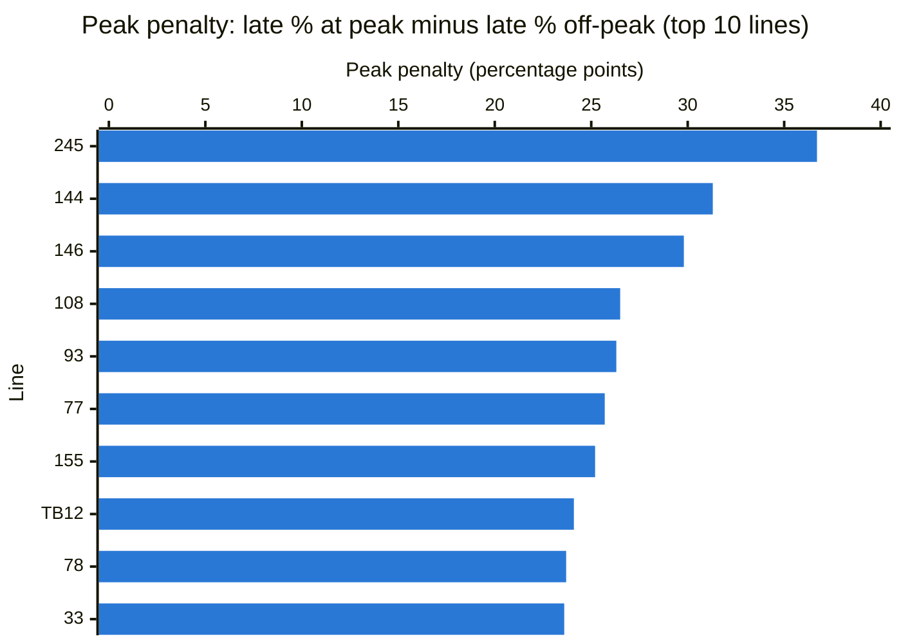

# Analytics Insights

What the analytics scripts in `analytics/` found, task by task. Each insight names the script it comes from and its
limits.

> **Read this first.** Lines, stops, cities, stop order and the planned timetable come from TCL open data. **Delays,
> cancellations, skipped stops, vehicles and passenger counts are simulated.** The insights describe the analysis
> method, not the performance of the real TCL network. The warehouse currently holds **one service day
> (2026-09-08, a Tuesday)**, and passenger counts exist only for vehicles with a passenger counter (about 25 %).

## Business definitions

Used the same way in every script:

| Term | Definition |
|---|---|
| Delay | Actual arrival − planned arrival, in seconds, on operated stops only. |
| On time | Delay between −60 s and +180 s. |
| Late / Early | Delay > 180 s / delay < −60 s. |
| Line in difficulty | More than 20 % of its passages late over the period. |
| Cancellation rate | Cancelled runs / planned runs (runs, not stop rows). |
| Passenger measures | Computed on vehicles with a passenger counter only, and labelled as such. |
| Peak hours | 07:00–08:59 and 16:00–18:59 of the service day; every other hour is off-peak. |

---

## 1. Database exploration

Source: `analytics/eda/01_database_exploration.sql`

- **What analysts can use:** 6 gold tables: 2 facts (`fact_trips`, `fact_line_stops`) and 4 dimensions (dates, lines,
  stops, vehicles). There are no analytics views yet. Dimension counts need care:
  - `dim_lines` (1,585 rows) holds one row per line and direction.
  - `dim_stops` (9,774) and `dim_vehicles` (2,037) each include one `n/a` member, so there are 9,773 stops and 2,036
    vehicles.
  - `dim_dates` is a calendar of 365 days, of which only one is a service day.
- **471,946 is not the number of runs:** one row of `fact_trips` is one run at one stop on one service day. Every
  count of runs must be made on (`run_id`, `date_key`), never with `COUNT(*)`.
- **The measures are nullable,** so `COUNT(*)`, `COUNT(column)` and `AVG(column)` answer different questions:
  - **Delay** is filled on 464,281 rows, the stops actually served.
  - **Boardings** are filled on 117,687 rows (about 25 %), the vehicles with a counter.
  - **Consequence:** `AVG` ignores NULLs, so an average delay covers served stops only, and a passenger average
    covers equipped vehicles only.

**Limits:**
- One service day, so no trends over days or weeks yet.
- No traffic alerts and no cancellation reason in the warehouse.
- `date_key` and `line_key` are nullable by design. They have no NULLs today, but joins should be checked again after
  each load.

## 2. Dimensions exploration

Source: `analytics/eda/02_dimensions_exploration.sql`

- **The network is mostly school buses:** of the 801 lines, 780 are bus lines and 589 (74 %) are School lines. Only
  205 are Regular (185 bus, 8 tram, 5 trolleybus, 4 metro, 2 funicular, 1 river shuttle). Unless rankings and
  averages by line are split by category, or limited to Regular lines, School services will dominate them. Each
  ranking must also name its unit: a line (`line_code`) or a line-direction (`line_key`).
- **City is unknown for 46 % of stops** (4,490 of 9,773), while every stop has a fare zone:
  - a breakdown by city covers only about half of the network;
  - fare zone is the complete geographic dimension.

  Wheelchair access is unknown for 25 % of stops, so accessibility shares must show that bucket, not drop it.
- **Statuses are counted in stop rows, not runs:** 464,281 operated, 4,373 cancelled and 3,292 skipped. So 1.6 % of
  planned stops were not served. Cancelled runs are counted in Task 4. The fleet has 2,036 vehicles (87 % buses) in
  15 depots.

## 3. Date range exploration

Source: `analytics/eda/03_date_range_exploration.sql`

- **A service day is longer than a calendar day:** the service day of Tuesday 2026-09-08 runs from 00:00 until 00:41
  the next day. Its last 1,218 passages (114 runs) are therefore dated 2026-09-09. Group by service day (`date_key`),
  never by the calendar date of `planned_arrival`. For hours, use a service hour from 0 to 24: `planned_hour` puts
  both midnights in hour 0.
- **There is a night pause and two peaks:**
  - no service between 01:42 and 04:12;
  - the busiest hours are 7–8 am (37,827 passages) and 5–6 pm (38,423);
  - the last actual arrival comes 129 s after the last planned one.
- **Fleet and line versions:** vehicles are 0 to 48 years old (9.0 on average, 6 with an unknown date; simulated).
  46 School lines got a new version on 2026-09-01, the start of the school year. Gold keeps only current versions, so
  there is no earlier version to compare them with.

## 4. Measures exploration

Source: `analytics/eda/04_measures_exploration.sql`

- **Cancellations are rare, skipped stops less so:** 22,427 planned runs made 471,946 passages (about 21 per run).
  - **Cancelled runs:** 184 (0.82 %). They were always cancelled in full, so 4,373 passages were lost.
  - **Runs with a skipped stop:** 1,952 (8.7 %) skipped at least one stop.
- **Delays have a long tail:** the average is 149.7 s, but the median is 74 s, the 95th percentile 586 s and the
  maximum 3,921 s.
  - **What to report:** a few very late passages pull the average up, so report the median (the typical passenger)
    and the 95th percentile (the bad cases).
  - **Punctuality:** 69.4 % on time, 29.5 % late, 1.1 % early.
  - **The difficulty threshold:** the network as a whole is above the 20 % "line in difficulty" threshold. Before
    Task 10 uses that threshold, check how many lines exceed it.
- **Coverage and passengers:**
  - **Coverage:** 774 of the 801 lines ran on this Tuesday (the other 27 are checked by category in Task 5), along
    with 9,472 of 9,773 stops and 1,985 vehicles.
  - **Passengers:** the 495 equipped vehicles counted 578,899 boardings and 578,843 alightings. The two almost balance,
    which shows the counts are consistent. These totals cover about a quarter of the fleet, not the network's
    ridership.

## 5. Magnitude analysis

Source: `analytics/eda/05_magnitude_analysis.sql`

- **Counting lines misleads:** School lines are 580 of the 774 lines that ran, but they make only 7 % of runs
  (1,562) and 4 % of passages. Regular lines make 93 % of runs. Measure the size of a service in runs or passages,
  not in lines. School runs are also cancelled a little more often (1.09 % vs 0.80 %).
- **Punctuality depends on the mode:**
  - **Median delay:** buses 97 s, trolleybuses 75 s, trams 55 s, metro 7 s.
  - **Share of late passages:** the metro, funicular and river shuttle are never late; trams are 20.5 % late (just
    over the "in difficulty" threshold) and buses 33.6 %.
  - **Consequence:** a ranking that mixes modes only ranks the modes, so rank lines within a mode. Delays are
    simulated.
- **Service and passengers are concentrated in Zone 1:** 86 % of passages and 93 % of counted boardings. The busiest
  cities are Lyon 3e, Lyon 9e and Villeurbanne. Compared per counted passage, a metro passage counts 28.5 boardings
  and a bus passage 2.2. The funicular has no counters, so it is missing from every passenger measure.
- **The 27 lines that did not run are plausible for a Tuesday:**
  - night lines (PL1–PL4);
  - the Grand Parc shuttles (N180–N184);
  - the stadium event shuttles;
  - replacement buses;
  - 9 school lines.

## 6. Ranking analysis

Source: `analytics/eda/06_ranking_analysis.sql`

- **The 10 most late lines are all buses:** among Regular lines with at least 20 runs (163 lines), they range from 80
  (55.1 % late) to C22EX (45.8 %). Within each mode, the most late are T2 (23.5 %) for trams and C14 (38.7 %) for
  trolleybuses. Only a ranking within a mode compares like with like.
- **Ties and small lines change the answer:**
  - **Ties:** 7 lines are tied at 0 % late (metro A–D, funicular F1–F2, river shuttle NAVI1). `TOP 5` drops two of
    them at random, while `TOP 5 WITH TIES` or `RANK` keeps them all.
  - **Exact values:** rank on the exact percentage. Lines 71 and C22 both show 21.8 % but are not tied.
  - **Small lines:** without a minimum volume, the most cancelled lines are school lines at 50 % (1 cancellation out
    of 2 runs). With at least 20 runs, line 80 leads (5 of 90). Line 130's 5 % rests on a single cancellation.
- **Line 80 is both the most late and the most cancelled line.** Delays and cancellations are simulated, so this is a
  pattern to check over a full month, not a conclusion.
- **Busiest stations and cities:** a station is all the platforms with the same name.
  - **Stations:** Gorge de Loup (16,262 counted boardings on 21 platforms), Saxe - Gambetta and Gare de Vaise.
  - **Cities:** Villeurbanne, Lyon 3e and Lyon 9e get the most service.

## 7. Change-over-time analysis

Source: `analytics/advanced/07_change_over_time_analysis.sql`

With one service day, time is analysed by **service hour** (0 to 24, where 24 = after midnight), not by day or week.

The second chart starts at 04:00 because there is no service between 01:42 and 04:12, and a line cannot show the gap.
Hours 00 and 01 are in the table below.

Data by service hour

| Service hour | Planned passages | Average delay (s) | Late (%) | Boardings per counted passage |
|---|---:|---:|---:|---:|
| 00 | 3,005 | 71.7 | 14.5 | 0.4 |
| 01 | 455 | 59.4 | 10.1 | 0.2 |
| 04 | 846 | 54.1 | 9.6 | 0.8 |
| 05 | 9,353 | 78.2 | 18.4 | 1.7 |
| 06 | 22,362 | 98.6 | 21.8 | 3.0 |
| 07 | 37,827 | 150.8 | 31.1 | 6.6 |
| 08 | 35,358 | 207.4 | 37.4 | 7.8 |
| 09 | 29,294 | 197.3 | 36.1 | 4.8 |
| 10 | 24,443 | 141.8 | 27.8 | 3.7 |
| 11 | 23,955 | 121.0 | 25.4 | 3.7 |
| 12 | 24,726 | 124.3 | 26.3 | 4.5 |
| 13 | 24,637 | 130.8 | 27.7 | 4.4 |
| 14 | 24,338 | 128.2 | 28.7 | 4.1 |
| 15 | 25,836 | 125.8 | 25.6 | 4.5 |
| 16 | 32,691 | 148.9 | 30.0 | 6.0 |
| 17 | 38,423 | 189.0 | 36.0 | 7.3 |
| 18 | 36,227 | 227.5 | 40.1 | 6.6 |
| 19 | 28,621 | 169.3 | 31.0 | 4.7 |
| 20 | 20,364 | 107.3 | 23.1 | 2.8 |
| 21 | 12,524 | 93.8 | 21.2 | 2.2 |
| 22 | 8,655 | 72.0 | 15.7 | 1.6 |
| 23 | 6,788 | 54.8 | 11.5 | 1.3 |
| 24 | 1,218 | 58.0 | 11.9 | 0.4 |

- **Delays follow the traffic peaks one hour later:**
  - **Traffic:** passages peak at 07:00 (37,827) and 17:00 (38,423). The busiest 15 minutes start at 07:30.
  - **Delays:** the late share peaks at 08:00 (37.4 %) and 18:00 (40.1 %). At 09:00 it is still 36.1 %, although
    passages have fallen by 17 %.
  - **Reading:** delays build up during a peak and take about an hour to clear. Delays are simulated.
- **Peak hours are the weak point:** they carry 38 % of operated passages, but only 63–65 % of them are on time,
  against 73 % off-peak. Runs starting at the peak are cancelled about twice as often: 1.19 % (morning) and 1.09 %
  (evening), against 0.61 %.
- **Passengers follow the same curve:** 7.8 boardings per counted passage at 08:00 and 7.3 at 17:00, against fewer
  than 1 at night. So delays and cancellations are highest exactly when the most passengers are on board. Weekday vs
  weekend cannot be compared with a single Tuesday.

## 8. Cumulative analysis

Source: `analytics/advanced/08_cumulative_analysis.sql`

**Blue bars:** running share of the day's planned passages (service). **Orange line:** running share of the day's
counted boardings (demand, equipped vehicles). When the line is above the bars, demand is running ahead of service.

Data by service hour

| Service hour | Running passages | Passages (%) | Running boardings | Boardings (%) | Average delay (s) | 3-hour moving average, simple (s) | 3-hour moving average, weighted (s) |
|---|---:|---:|---:|---:|---:|---:|---:|
| 00 | 3,005 | 0.6 | 417 | 0.1 | 71.7 | 71.7 | 71.7 |
| 01 | 3,460 | 0.7 | 436 | 0.1 | 59.4 | 65.6 | 70.1 |
| 02 | 3,460 | 0.7 | 436 | 0.1 | – | 65.6 | 70.1 |
| 03 | 3,460 | 0.7 | 436 | 0.1 | – | 59.4 | 59.4 |
| 04 | 4,306 | 0.9 | 659 | 0.1 | 54.1 | 54.1 | 54.1 |
| 05 | 13,659 | 2.9 | 5,116 | 0.9 | 78.2 | 66.2 | 76.2 |
| 06 | 36,021 | 7.6 | 22,181 | 3.8 | 98.6 | 77.0 | 91.6 |
| 07 | 73,848 | 15.6 | 83,596 | 14.4 | 150.8 | 109.2 | 124.1 |
| 08 | 109,206 | 23.1 | 152,216 | 26.3 | 207.4 | 152.3 | 159.5 |
| 09 | 138,500 | 29.3 | 187,385 | 32.4 | 197.3 | 185.2 | 183.6 |
| 10 | 162,943 | 34.5 | 209,849 | 36.2 | 141.8 | 182.2 | 186.0 |
| 11 | 186,898 | 39.6 | 232,038 | 40.1 | 121.0 | 153.4 | 156.2 |
| 12 | 211,624 | 44.8 | 259,407 | 44.8 | 124.3 | 129.0 | 129.1 |
| 13 | 236,261 | 50.1 | 286,095 | 49.4 | 130.8 | 125.3 | 125.4 |
| 14 | 260,599 | 55.2 | 311,226 | 53.8 | 128.2 | 127.8 | 127.8 |
| 15 | 286,435 | 60.7 | 340,759 | 58.9 | 125.8 | 128.3 | 128.2 |
| 16 | 319,126 | 67.6 | 389,017 | 67.2 | 148.9 | 134.3 | 135.6 |
| 17 | 357,549 | 75.8 | 459,113 | 79.3 | 189.0 | 154.5 | 158.6 |
| 18 | 393,776 | 83.4 | 518,987 | 89.7 | 227.5 | 188.5 | 189.7 |
| 19 | 422,397 | 89.5 | 552,510 | 95.4 | 169.3 | 195.3 | 197.0 |
| 20 | 442,761 | 93.8 | 566,243 | 97.8 | 107.3 | 168.0 | 179.1 |
| 21 | 455,285 | 96.5 | 572,906 | 99.0 | 93.8 | 123.5 | 133.4 |
| 22 | 463,940 | 98.3 | 576,645 | 99.6 | 72.0 | 91.0 | 95.9 |
| 23 | 470,728 | 99.7 | 578,779 | 100.0 | 54.8 | 73.6 | 77.5 |
| 24 | 471,946 | 100.0 | 578,899 | 100.0 | 58.0 | 61.6 | 64.0 |

- **Demand is more concentrated in the peaks than the service is:**
  - **Halfway points:** half of the planned passages are done by the end of the 13:00 hour; half of the counted
    boardings come during the 14:00 hour.
  - **During the peaks, passengers run ahead of service:** by the end of 09:00, the day has made 29 % of its passages
    but carried 32 % of its boardings; by the end of 18:00, 83 % against 90 %.
  - **Caveat:** passenger counts are simulated and cover equipped vehicles only.
- **The weighted moving average is the right one:** it is calculated from the sums over the 3-hour window. Averaging
  the hourly averages gives a quiet hour as much weight as a peak hour. At 07:00, the simple average gives 109.2 s
  against 124.1 s weighted, because the simple one counts 05:00 (9,231 passages) as much as 07:00 (36,995).
- **Smoothing delays the peak:** the weighted 3-hour average peaks at 19:00 (197.0 s for 17:00–19:59), one hour after
  the raw peak at 18:00 (227.5 s). A trailing window flattens a peak and moves it later. The hour axis is complete
  (hours 2 and 3 filled with no service), otherwise the window at 04:00 would include the night hours 0 and 1.

## 9. Performance analysis

Source: `analytics/advanced/09_performance_analysis.sql`

With one service day, each line is compared with **its own average for the day** and with **the previous time band**,
instead of the previous week. Scope: the 163 Regular lines with at least 20 runs.

**Lines per time band:**

| Time band | Lines | Above their own average | Degrading vs previous band | Improving vs previous band |
|---|---:|---:|---:|---:|
| Early (00:00–06:59) | 155 | 37 | – | – |
| Morning peak (07:00–08:59) | 162 | 111 | 119 | 29 |
| Midday (09:00–15:59) | 160 | 53 | 43 | 110 |
| Evening peak (16:00–18:59) | 162 | 123 | 121 | 34 |
| Evening (19:00–00:59) | 158 | 39 | 36 | 115 |

Peak and off-peak late % of the top 10 lines

| Line | Mode | Passages at peak | Passages off-peak | Late at peak (%) | Late off-peak (%) | Peak penalty (points) |
|---|---|---:|---:|---:|---:|---:|
| 245 | Bus | 412 | 446 | 57.5 | 20.9 | 36.7 |
| 144 | Bus | 301 | 233 | 38.2 | 6.9 | 31.3 |
| 146 | Bus | 243 | 197 | 35.4 | 5.6 | 29.8 |
| 108 | Bus | 533 | 1,333 | 53.3 | 26.8 | 26.5 |
| 93 | Bus | 879 | 1,580 | 64.3 | 38.0 | 26.3 |
| 77 | Bus | 939 | 1,469 | 66.9 | 41.2 | 25.7 |
| 155 | Bus | 346 | 577 | 53.5 | 28.2 | 25.2 |
| TB12 | Bus | 721 | 1,972 | 43.3 | 19.2 | 24.1 |
| 78 | Bus | 1,301 | 1,932 | 49.2 | 25.5 | 23.7 |
| 33 | Bus | 2,182 | 3,980 | 57.6 | 33.9 | 23.6 |

Lines with at least 100 passages at peak and off-peak (157 lines).

- **The peaks hurt almost every line, so this is a network pattern, not a line problem:**
  - **At each peak:** about 7 lines in 10 are above their own average and getting worse.
  - **After each peak:** most recover in the next band (110 improve at midday, 115 in the evening).
  - **Peak vs off-peak:** 129 of 163 lines are later at peak, and only 26 are better.
  - **Reading:** when nearly every line degrades at the same time, the cause is shared (traffic, crowding). So
    network-wide measures at the peak, such as bus lanes and peak timetables, come before line-by-line plans. Delays
    are simulated.
- **Some lines only have a problem at the peak:**
  - **Peak-only lines:** 144 and 146 are almost punctual off-peak (6.9 % and 5.6 % late) but more than 35 % late at
    the peak. A fix limited to the peak (timetable padding, bus priority) addresses their whole problem.
  - **Lines late all day:** 93 and 77 are already 38–41 % late off-peak and get worse at the peak. They need more
    than a peak fix.
- **Most bus lines are "better than average" because the average is weighted:** 96 of 143 bus lines are below the
  bus average (33.9 % late), and only 47 above.
  - **The lines above average are the big ones:** 3,204 passages per line against 1,962, so they make 44 % of bus
    passages.
  - **Effect on the average:** they pull the weighted average up to 33.9 %, while the simple average of the line
    rates is 31.4 %.
